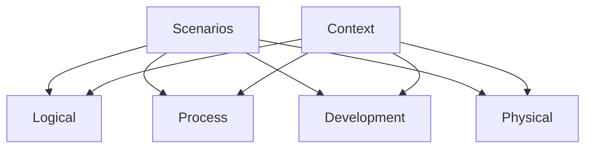

# Architecture

System architecture following the **4+1** view model.

| View | Purpose |
| --- | --- |
| [System context](context-system/context.md) | Scope, actors, external systems |
| [Logical view](logical-view/view.md) | Components, responsibilities, relationships |
| [Process view](process-view/view.md) | Concurrency, performance, availability |
| [Development view](development-view/view.md) | Code organization, modules, dependencies |
| [Physical view](physical-view/view.md) | Deployment, infrastructure, networks |
| [Scenarios](scenarios/view.md) | Use cases that validate the views |

