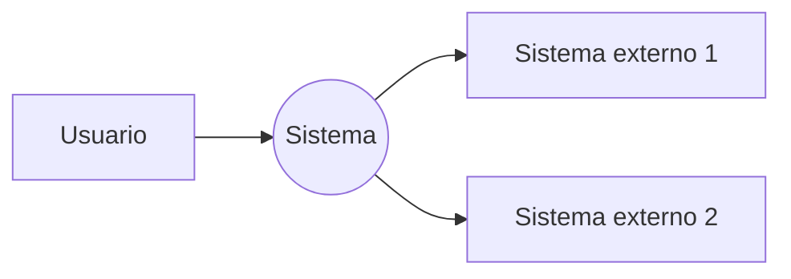

# Contexto del Sistema

## Propósito

Delimitar el alcance del sistema: qué se construye, quién lo usa y con qué sistemas externos interactúa.

## Alcance

- **Nombre del sistema:** _(completar)_
- **Objetivo:** _(problema que resuelve)_
- **Límites:** qué queda dentro y fuera del alcance del trabajo de grado.

## Actores

| Actor | Tipo | Descripción |
| --- | --- | --- |
| _(Nombre)_ | Usuario / Sistema | _(Responsabilidad)_ |

## Sistemas externos

| Sistema | Tipo de integración | Descripción |
| --- | --- | --- |
| _(Nombre)_ | API / BD / Servicio | _(Qué se intercambia)_ |

## Diagrama de contexto

## Requisitos de contexto

- _(Restricciones, normativas, supuestos del entorno)_
