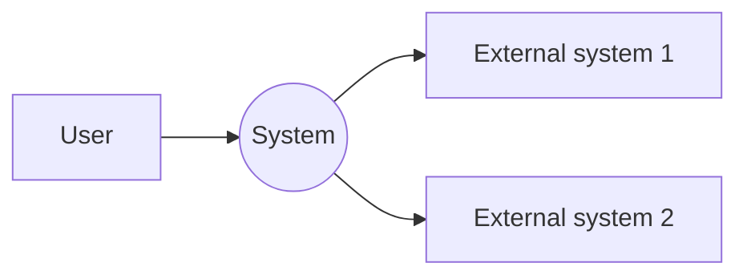

# System Context

## Scope

- **System:** _(name)_
- **Goal:** _(problem solved)_
- **Boundaries:** _(in / out of scope)_

## Actors

| Actor | Type | Description |
| --- | --- | --- |
| _(name)_ | User / System | _(responsibility)_ |

## External systems

| System | Integration | Description |
| --- | --- | --- |
| _(name)_ | API / DB / Service | _(data exchanged)_ |

## Context diagram

## Constraints

- _(regulations, assumptions)_
