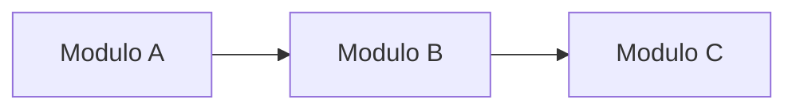

# Vista de Desarrollo

## Propósito

Describir cómo se organiza el software a nivel de código: módulos, paquetes, dependencias y artefactos que apoyan el trabajo del equipo de desarrollo.

## Organización del código

```
proyecto/
├── backend/
├── frontend/
├── infra/
└── docs/
```

## Módulos

| Módulo | Responsabilidad | Dependencias |
| --- | --- | --- |
| _(Nombre)_ | _(Qué contiene)_ | _(Módulos)_ |

## Dependencias entre módulos



## Tecnologías y herramientas

| Capa | Tecnología | Version |
| --- | --- | --- |
| _(Backend)_ | _(Framework)_ | _(x.y)_ |
| _(Frontend)_ | _(Framework)_ | _(x.y)_ |
| _(BD)_ | _(Motor)_ | _(x.y)_ |

## Convenciones

- **Ramas:** _(git flow, trunk based)_
- **Versionado:** _(SemVer, etc.)_
- **Pruebas:** _(unitarias, integración, e2e)_
- **CI/CD:** _(pipeline)_
