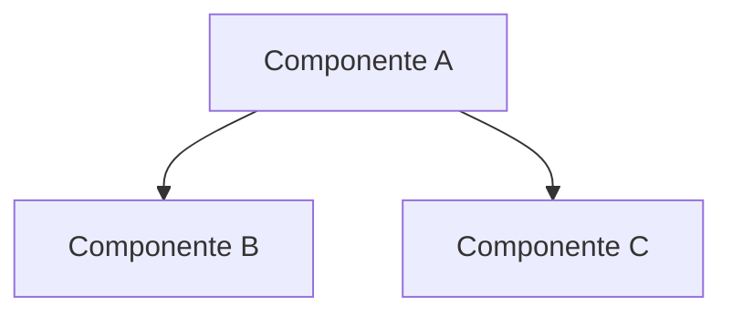

# Vista Lógica

## Propósito

Describir la estructura de la solución en términos de componentes, sus responsabilidades, interfaces y relaciones, sin atarse a la tecnología de despliegue.

## Principios de diseño

- Separación de responsabilidades.
- Bajo acoplamiento, alta cohesión.
- _(Agregar principios propios del dominio)_

## Componentes

| Componente | Responsabilidad | Depende de |
| --- | --- | --- |
| _(Nombre)_ | _(Qué hace)_ | _(Componentes)_ |

## Modelo de dominio

| Entidad | Descripción | Atributos clave |
| --- | --- | --- |
| _(Entidad)_ | _(Descripción)_ | _(Atributos)_ |

## Diagrama de componentes

## Patrones y decisiones

- **Patrón:** _(MVC, capas, hexagonal, etc.)_ — _(justificación)_
- **ADRs relacionados:** _(enlaces)_
