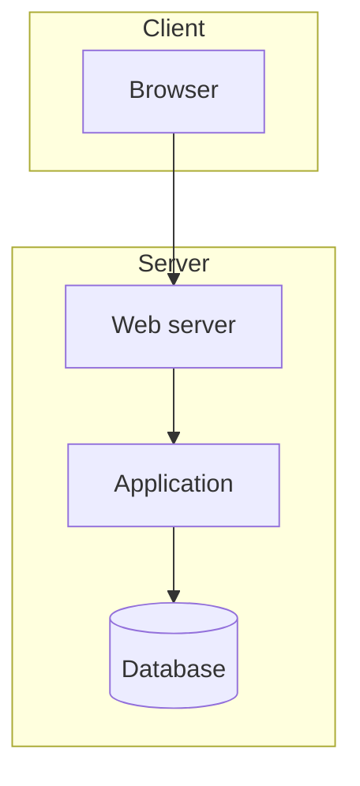

# Physical View

Deployment on infrastructure: nodes, environments, networks, and component distribution.

## Nodes

| Node | Type | Specs | Deployed components |
| --- | --- | --- | --- |
| _(name)_ | VM / Container / Physical | _(CPU, RAM, disk)_ | _(components)_ |

## Environments

| Environment | Purpose | URL / Access |
| --- | --- | --- |
| Development | _(local)_ | _(localhost)_ |
| Testing | _(QA)_ | _(url)_ |
| Production | _(live)_ | _(url)_ |

## Deployment diagram

## Network and security

- **Network zones:** _(DMZ, internal)_
- **TLS:** _(certificates, termination)_
- **Backups:** _(frequency, retention)_
