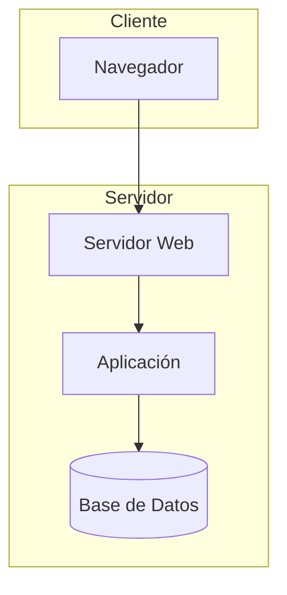

# Vista Física

## Propósito

Describir el despliegue del sistema sobre infraestructura: nodos, entornos, redes y distribución de componentes.

## Nodos e infraestructura

| Nodo | Tipo | Especificaciones | Componentes desplegados |
| --- | --- | --- | --- |
| _(Nombre)_ | VM / Contenedor / Físico | _(CPU, RAM, disco)_ | _(Componentes)_ |

## Entornos

| Entorno | Propósito | URL / Acceso |
| --- | --- | --- |
| Desarrollo | _(local)_ | _(localhost)_ |
| Pruebas | _(QA)_ | _(url)_ |
| Producción | _(real)_ | _(url)_ |

## Diagrama de despliegue

## Redes y seguridad

- **Zonas de red:** _(DMZ, red interna)_
- **TLS:** _(certificados, terminación)_
- **Backups:** _(frecuencia, retención)_
