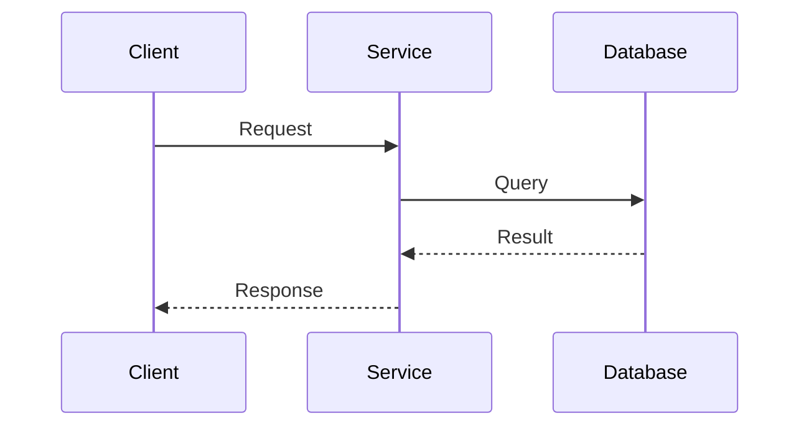

# Process View

Runtime behavior: concurrency, communication, performance, scalability, and availability.

## Processes

| Process | Type | Responsibility | Concurrency |
| --- | --- | --- | --- |
| _(name)_ | Service / Thread / Task | _(what it runs)_ | Sync / Async |

## Communication

| From | To | Protocol | Pattern |
| --- | --- | --- | --- |
| _(component)_ | _(component)_ | HTTP / Messaging / DB | Sync / Async |

## Non-functional requirements

| Attribute | Target | Strategy |
| --- | --- | --- |
| Performance | _(e.g. < 300 ms P95)_ | _(cache, indexing)_ |
| Availability | _(e.g. 99.5%)_ | _(replicas, health checks)_ |
| Scalability | _(expected growth)_ | _(horizontal / vertical)_ |

## Sequence diagram

