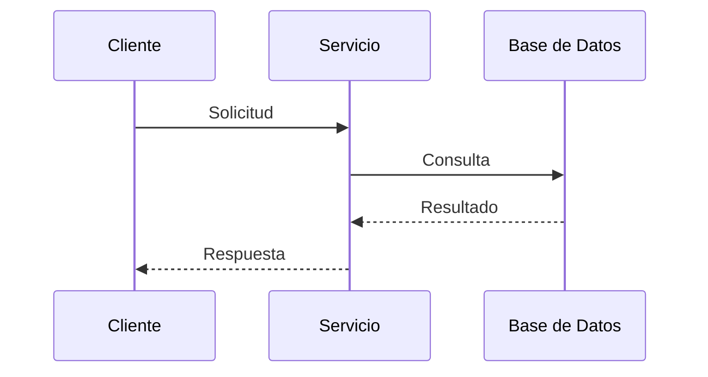

# Vista de Procesos

## Propósito

Describir el comportamiento dinámico del sistema: concurrencia, comunicación entre procesos, rendimiento, escalabilidad y disponibilidad.

## Procesos y concurrencia

| Proceso | Tipo | Responsabilidad | Concurrencia |
| --- | --- | --- | --- |
| _(Nombre)_ | Servicio / Hilo / Tarea | _(Qué ejecuta)_ | _(Sincrónico/Asíncrono)_ |

## Comunicación

| Origen | Destino | Protocolo | Patrón |
| --- | --- | --- | --- |
| _(Componente)_ | _(Componente)_ | HTTP / Mensajería / BD | _(Sync/Async, request-response, pub-sub)_ |

## Requisitos no funcionales

| Atributo | Objetivo | Estrategia |
| --- | --- | --- |
| Rendimiento | _(p. ej. < 300 ms P95)_ | _(caché, indexación)_ |
| Disponibilidad | _(p. ej. 99.5 %)_ | _(réplicas, health checks)_ |
| Escalabilidad | _(crecimiento esperado)_ | _(horizontal/vertical)_ |

## Diagrama de secuencia

