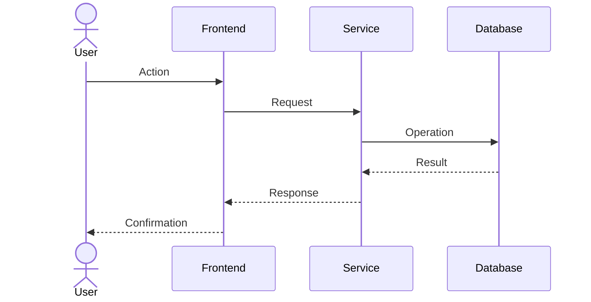

# Scenarios

Use cases that validate and connect the logical, process, development, and physical views.

## Scenarios

| ID | Scenario | Actor | Views |
| --- | --- | --- | --- |
| E-01 | _(use case)_ | _(actor)_ | Logical, Process, Physical |
| E-02 | _(use case)_ | _(actor)_ | Logical, Development |

## Details

### E-01 — _(name)_

- **Goal:** _(what the actor achieves)_
- **Preconditions:** _(initial state)_
- **Main flow:**
  1. _(step)_
  2. _(step)_
- **Alternate flows:** _(errors, exceptions)_
- **Components:** _(logical view references)_
- **Nodes:** _(physical view references)_

### E-02 — _(name)_

- **Goal:** _(what the actor achieves)_
- **Preconditions:** _(initial state)_
- **Main flow:**
  1. _(step)_
- **Components:** _(references)_

## Requirement traceability

| Requirement | Scenario | Status |
| --- | --- | --- |
| _(RF-01)_ | E-01 | _(Covered)_ |
