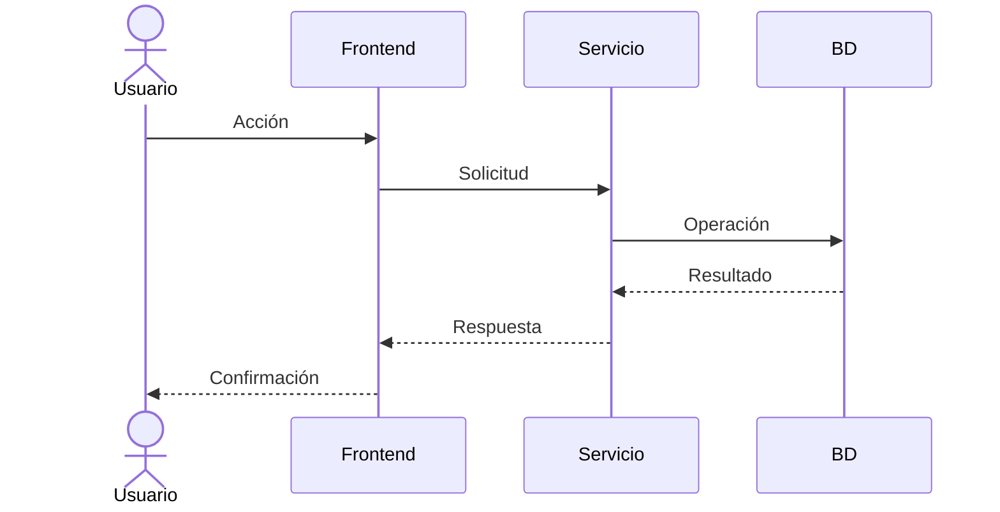

# Escenarios

## Propósito

Validar la arquitectura mediante casos de uso representativos que recorren las vistas lógica, de procesos, de desarrollo y física. Los escenarios cohesionan y verifican el resto del modelo 4+1.

## Escenarios principales

| ID | Escenario | Actor | Vistas involucradas |
| --- | --- | --- | --- |
| E-01 | _(Nombre del caso de uso)_ | _(Actor)_ | Lógica, Procesos, Física |
| E-02 | _(Nombre del caso de uso)_ | _(Actor)_ | Lógica, Desarrollo |

## Detalle de escenarios

### E-01 — _(Nombre)_

- **Objetivo:** _(qué logra el actor)_
- **Precondiciones:** _(estado inicial)_
- **Flujo principal:**
  1. _(Paso)_
  2. _(Paso)_
- **Flujos alternativos:** _(errores, excepciones)_
- **Componentes participantes:** _(referencias a vista lógica)_
- **Nodos implicados:** _(referencias a vista física)_

### E-02 — _(Nombre)_

- **Objetivo:** _(qué logra el actor)_
- **Precondiciones:** _(estado inicial)_
- **Flujo principal:**
  1. _(Paso)_
- **Componentes participantes:** _(referencias)_

## Trazabilidad con requisitos

| Requisito | Escenario | Estado |
| --- | --- | --- |
| _(RF-01)_ | E-01 | _(Cubierto)_ |
